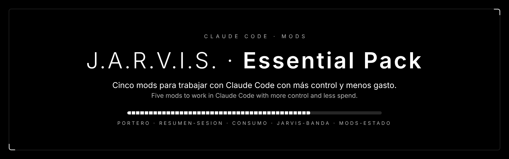
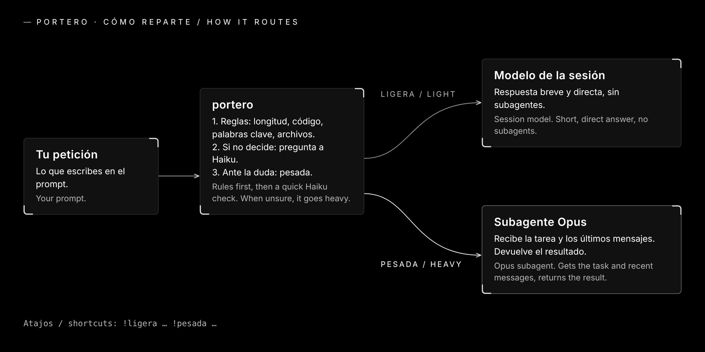
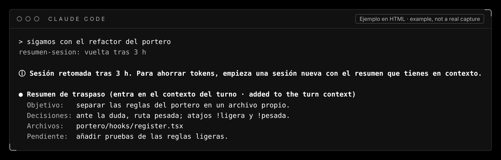
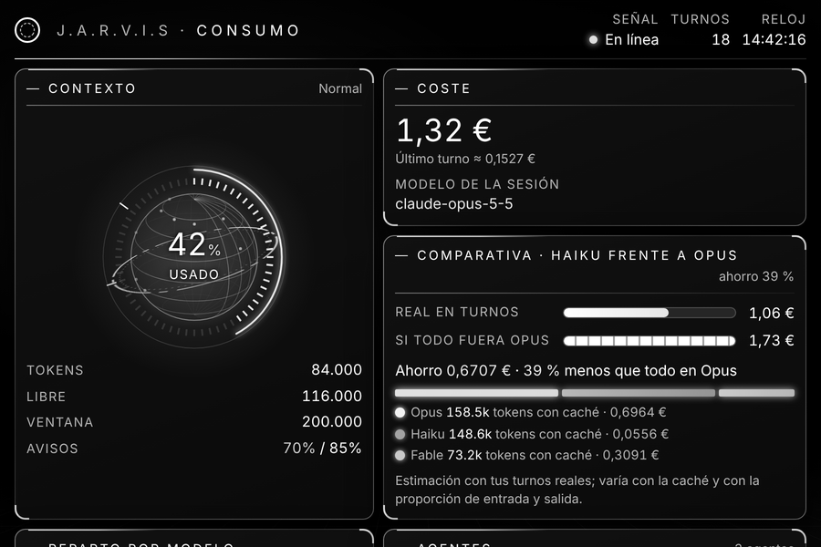
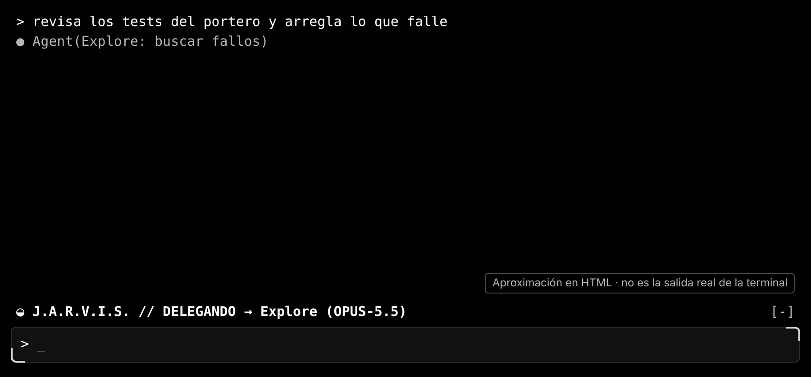
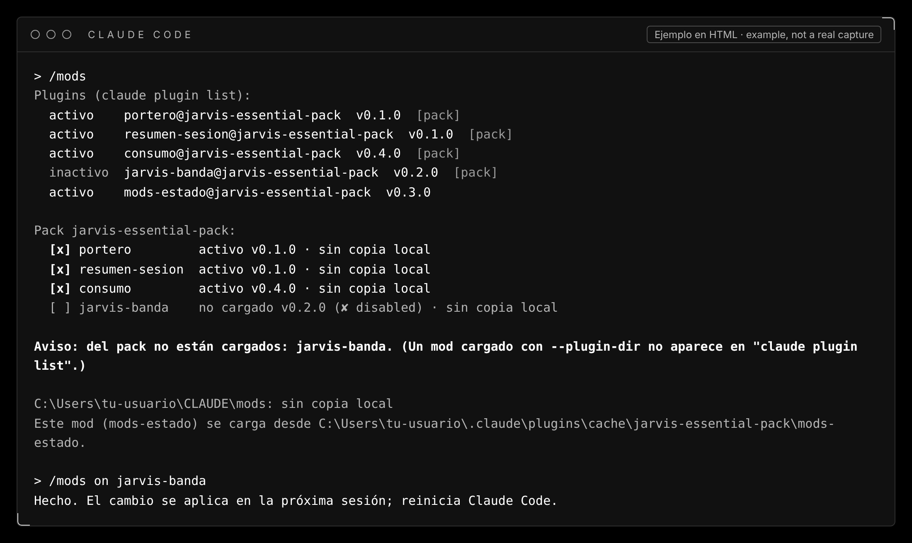

<a id="top"></a>



<p align="center"><b>Cinco mods para Claude Code con estilo J.A.R.V.I.S.: reparten el trabajo entre modelos, muestran el consumo y te dicen en qué está la sesión.</b></p>

<p align="center">
  <a href="LICENSE"></a>
  <a href="https://docs.claude.com/en/docs/claude-code"></a>
  <a href="CHANGELOG.md"></a>
  <a href="CONTRIBUTING.md"></a>
</p>

<p align="center"><b>Español</b> · <a href="#en">English</a></p>

---

<a id="es"></a>

## Índice

- [Novedades](#es-novedades)
- [Los mods](#es-mods)
- [Instalación](#es-instalacion)
- [Cargar los mods en cada sesión](#es-cargar)
- [Configurar las carpetas](#es-carpetas)
- [Cómo funciona por dentro](#es-funciona)
- [Requisitos](#es-requisitos)
- [Limitaciones conocidas](#es-limites)
- [Contribuir](#es-contribuir)
- [Licencia](#es-licencia)

<a id="es-novedades"></a>

## Novedades

**Versión 0.4.0 del pack**

Todo el pack pasa a una estética monocroma (blanco, grises y negro), también en las imágenes.

- **consumo 0.8.0:** histórico entre sesiones (bloque Acumulado: hoy, semana, total y últimas sesiones), costes en euros por defecto (`moneda` y `tipoCambio`), tema `monocromo` por defecto, densidad automática según el tamaño de la ventana y sin parpadeo. `/jarvis` sigue abriendo y cerrando el HUD.
- **portero 0.2.0:** clasificación por capas, override `!dudosa`, registro local de decisiones y comando `/portero`.
- **resumen-sesion 0.2.0:** resumen de traspaso en secciones, comandos `/resumen` y `/resumen-ver`, y el último resumen guardado en disco.
- **jarvis-banda 0.3.0:** siete estados, modelo y contexto en la misma línea, color monocromo por defecto y comando `/banda`.
- **mods-estado 0.4.0:** `/mods` como diagnóstico del pack (versión instalada y copia local, fallos de carga, restos del marketplace antiguo), `/mods actualizar` y `/mods ayuda`, en blanco y grises.

**Versión 0.3.0 del pack**

- **consumo 0.4.0 y mods-estado 0.3.0:** sin rutas fijas de Windows. La carpeta de datos del HUD (`dataDir`) y la carpeta del pack (`modsDir`) se configuran con `claude plugin configure`; por defecto, `~/CLAUDE/consumo` y `~/CLAUDE/mods` dentro de tu carpeta de usuario. Ver [Configurar las carpetas](#es-carpetas).

**Versión 0.2.0 del pack**

- **consumo 0.3.0:** comparativa Haiku frente a Opus en el HUD y comando `/jarvis` para abrir y cerrar la ventana.
- **mods-estado 0.2.0:** `/mods on <nombre>` y `/mods off <nombre>` activan o desactivan un mod del pack.
- **jarvis-banda 0.2.0:** una sola línea con el estado en vivo y el modelo del subagente al delegar.

Todos los cambios en [CHANGELOG.md](CHANGELOG.md).

<a id="es-mods"></a>

## Los mods

| Mod | Qué hace | Imagen |
|---|---|---|
| **[portero](portero/)**<br><sub>v0.2.0</sub> | Mira cada petición y decide quién la hace, por capas de reglas. Lo ligero, el modelo de la sesión. Lo pesado, un subagente Opus. `/portero` enseña el reparto. |  |
| **[resumen-sesion](resumen-sesion/)**<br><sub>v0.2.0</sub> | Si vuelves tras 2 horas sin escribir, o con `/resumen`, Haiku escribe un resumen de traspaso en secciones para seguir en una sesión nueva. `/resumen-ver` muestra el último. |  |
| **[consumo](consumo/)**<br><sub>v0.8.0</sub> | Ventana HUD en directo, monocroma por defecto: barra del plan, contexto usado, coste en euros, tokens por agente y por modelo, comparativa Haiku frente a Opus y acumulado entre sesiones. `/jarvis` la abre o la cierra. |  |
| **[jarvis-banda](jarvis-banda/)**<br><sub>v0.3.0</sub> | Una línea monocroma encima del prompt con el estado en vivo (esperando, procesando, pensando, ejecutando, delegando, permiso o error), el modelo y el contexto. `/banda` cambia idioma y modo. |  |
| **[mods-estado](mods-estado/)**<br><sub>v0.4.0</sub> | Comando `/mods`: diagnóstico del pack (estado, versión instalada y de tu copia local, fallos de carga). `/mods on` y `/mods off` activan o desactivan un mod; `/mods actualizar` da los comandos para actualizar. |  |

Cada mod es independiente. Instala solo los que quieras.

<a id="es-instalacion"></a>

## Instalación

Dentro de Claude Code, en dos pasos:

**1. Añade el marketplace** (una sola vez):

```
/plugin marketplace add deriva1945-ui/portero-claude
```

**2. Instala cada mod que quieras:**

```
/plugin install <mod>@jarvis-essential-pack
```

Cambia `<mod>` por `portero`, `resumen-sesion`, `consumo`, `jarvis-banda` o `mods-estado`.
Ejemplo: `/plugin install consumo@jarvis-essential-pack`.

<a id="es-cargar"></a>

## Cargar los mods en cada sesión

Otra opción, sin instalar: guarda los mods en una carpeta tuya y Claude Code los carga con `--plugin-dir`.

### Copia local en una carpeta tuya

1. Copia las carpetas `portero`, `resumen-sesion`, `consumo`, `jarvis-banda` y `mods-estado` de este repo en una carpeta tuya, una carpeta por mod. En el ejemplo es `CLAUDE\mods` dentro de tu carpeta de usuario (`$env:USERPROFILE\CLAUDE\mods`), que es donde `mods-estado` busca por defecto.
2. Abre tu perfil de PowerShell con `notepad $PROFILE`.
3. Pega la función de abajo y guarda.
4. Abre una ventana nueva de PowerShell y escribe `claude`. Los mods se cargan solos.

### Función de PowerShell

```powershell
# Abre Claude Code con todos los mods del pack cargados.
function claude {
    $exe  = (Get-Command claude -CommandType Application | Select-Object -First 1).Source
    # Ejemplo: cambia la ruta si guardaste los mods en otra carpeta.
    $mods = Join-Path $env:USERPROFILE 'CLAUDE\mods'
    $dirs = 'portero', 'resumen-sesion', 'consumo', 'jarvis-banda', 'mods-estado' |
        ForEach-Object { '--plugin-dir'; Join-Path $mods $_ }
    & $exe @dirs @args
}
```

> [!TIP]
> La función busca el programa `claude` real, no la función, para no llamarse a sí misma.

> [!WARNING]
> No mezcles los dos métodos. Si instalas un mod con `/plugin install`, quítalo de la lista de la función.

En macOS o Linux vale lo mismo con `claude --plugin-dir ~/CLAUDE/mods/portero --plugin-dir ~/CLAUDE/mods/consumo …` o con un alias de tu shell.

<a id="es-carpetas"></a>

## Configurar las carpetas

Ningún mod usa rutas fijas. Cuatro mods tienen una opción de carpeta (`userConfig` en su `plugin.json`):

| Mod | Opción | Para qué | Valor por defecto |
|---|---|---|---|
| `consumo` | `dataDir` | dónde se escriben `index.html`, `datos.js`, `estado.json`, `estado.js` e `historico.json` | `~/CLAUDE/consumo` |
| `portero` | `dataDir` | dónde se guarda el registro `decisiones.jsonl` | `~/CLAUDE/portero` |
| `resumen-sesion` | `dataDir` | dónde se guarda `ultimo-resumen.md` | `~/CLAUDE/resumen-sesion` |
| `mods-estado` | `modsDir` | dónde está tu copia local del pack | `~/CLAUDE/mods` |

`~` es tu carpeta de usuario (`%USERPROFILE%` en Windows, `$HOME` en macOS y Linux). Acepta también una ruta absoluta.

**Mods instalados.** Al instalar, Claude Code te deja poner el valor. Después:

```
claude plugin configure consumo@jarvis-essential-pack
echo '{"dataDir": "~/CLAUDE/consumo"}' | claude plugin configure consumo@jarvis-essential-pack --values-stdin
```

La primera línea muestra las opciones y su valor; la segunda guarda uno nuevo (en el JSON usa `/` o dobla las `\\`). Dentro de Claude Code tienes `/plugin configure <mod>@jarvis-essential-pack` y `/config`.

**Mods cargados con `--plugin-dir`.** Pon los valores en `~/.claude/settings.json`:

```json
{
  "pluginConfigs": {
    "consumo": { "options": { "dataDir": "~/CLAUDE/consumo" } },
    "mods-estado": { "options": { "modsDir": "~/CLAUDE/mods" } }
  }
}
```

Los cambios se aplican al reiniciar Claude Code. Más detalle en el README de [consumo](consumo/README.md#es-carpeta) y de [mods-estado](mods-estado/README.md#es-carpeta).

<a id="es-funciona"></a>

## Cómo funciona por dentro

Todos los mods siguen el mismo camino: **eventos → hooks → datos → pantalla**.

| Paso | Qué pasa |
|---|---|
| **Eventos** | Claude Code avisa de lo que ocurre: empieza la sesión, envías un mensaje, corre una herramienta, nace un subagente, termina un turno. |
| **Hooks** | Cada mod escucha solo los eventos que necesita (`hooks/register.tsx`). |
| **Datos** | El mod guarda un estado pequeño: la hora del último turno, los tokens, el estado de la banda… |
| **Pantalla** | El resultado se ve en una línea, un aviso, una ventana HUD o una respuesta. |

Más detalle y un diagrama en [docs/como-funciona.md](docs/como-funciona.md).

<a id="es-requisitos"></a>

## Requisitos

- Claude Code con soporte de mods de terminal (plugins con `hooks/register.tsx`).
- `consumo`: Windows con Edge o Chrome para abrir la ventana, en modo aplicación (`--app`). En otros sistemas los datos se escriben igual y la página se abre a mano.
- `mods-estado`: el comando `claude` en el PATH.

<a id="es-limites"></a>

## Limitaciones conocidas

- **Sin audio en Windows.** Los mods no reproducen sonidos ni voz.
- **portero no cambia el modelo del hilo principal.** Si la sesión usa Opus, lo ligero también va con Opus. Para ahorrar, pon la sesión en Haiku con `/model`.
- **El HUD de consumo no se ha probado en todos los PC.** Puede variar con la versión de Windows, el navegador o el escalado de pantalla.
- **mods-estado no ve los mods cargados con `--plugin-dir`.** Salen como "no instalado" aunque estén en uso (salvo el propio mods-estado, que sale como "en uso"), y `/mods on` y `/mods off` no los cambian.
- **`/jarvis` no siempre cierra la ventana.** `window.close()` puede no funcionar en algunas versiones de Edge; entonces la página avisa y la cierras a mano.
- **Textos en español por defecto.** consumo, jarvis-banda, mods-estado y resumen-sesion tienen una opción de idioma (`idioma` o `language`) para pasar a inglés; portero solo está en español.

<a id="es-contribuir"></a>

## Contribuir

¿Ideas, fallos o mejoras? Lee [CONTRIBUTING.md](CONTRIBUTING.md).

- [Código de conducta](CODE_OF_CONDUCT.md)
- [Seguridad](SECURITY.md): cómo avisar de una vulnerabilidad sin publicarla.
- [Historial de cambios](CHANGELOG.md)

<a id="es-licencia"></a>

## Licencia

MIT © deriva1945-ui. Ver [LICENSE](LICENSE). Cada mod lleva también su propio `LICENSE`.

<p align="right"><a href="#top">↑ Arriba</a></p>

---

<a id="en"></a>

<p align="center"><a href="#es">Español</a> · <b>English</b></p>

<p align="center"><b>Five J.A.R.V.I.S.-style mods for Claude Code: they split work between models, show what you spend, and tell you what the session is doing.</b></p>

## Contents

- [What's new](#en-whats-new)
- [The mods](#en-mods)
- [Install](#en-install)
- [Load the mods in every session](#en-load)
- [Configure the folders](#en-folders)
- [How it works inside](#en-how)
- [Requirements](#en-requirements)
- [Known limitations](#en-limits)
- [Contributing](#en-contributing)
- [License](#en-license)

<a id="en-whats-new"></a>

## What's new

**Pack version 0.4.0**

The whole pack moves to a monochrome look (white, greys and black), images included.

- **consumo 0.8.0:** history across sessions (Accumulated block: today, this week, total and latest sessions), costs in euros by default (`moneda` and `tipoCambio`), `monocromo` as the default theme, automatic density from the window size and no flicker. `/jarvis` still opens and closes the HUD.
- **portero 0.2.0:** layered classification, `!dudosa` override, local decision log and the `/portero` command.
- **resumen-sesion 0.2.0:** handover summary in sections, `/resumen` and `/resumen-ver` commands, and the last summary saved to disk.
- **jarvis-banda 0.3.0:** seven states, model and context on the same line, monochrome colour by default and the `/banda` command.
- **mods-estado 0.4.0:** `/mods` as a pack check-up (installed version and local copy, load failures, leftovers from the old marketplace), `/mods update` and `/mods help`, in white and greys.

**Pack version 0.3.0**

- **consumo 0.4.0 and mods-estado 0.3.0:** no fixed Windows paths. The HUD data folder (`dataDir`) and the pack folder (`modsDir`) are set with `claude plugin configure`; by default, `~/CLAUDE/consumo` and `~/CLAUDE/mods` inside your user folder. See [Configure the folders](#en-folders).

**Pack version 0.2.0**

- **consumo 0.3.0:** Haiku versus Opus comparison in the HUD, and a `/jarvis` command that opens and closes the window.
- **mods-estado 0.2.0:** `/mods on <name>` and `/mods off <name>` enable or disable a pack mod.
- **jarvis-banda 0.2.0:** a single line with the live state, and the subagent's model while delegating.

Every change is in [CHANGELOG.md](CHANGELOG.md).

<a id="en-mods"></a>

## The mods

| Mod | What it does | Image |
|---|---|---|
| **[portero](portero/)**<br><sub>v0.2.0</sub> | Looks at each request and decides who handles it, through layers of rules. Light work: the session model. Heavy work: an Opus subagent. `/portero` shows the split. |  |
| **[resumen-sesion](resumen-sesion/)**<br><sub>v0.2.0</sub> | When you come back after 2 hours without typing, or with `/resumen`, Haiku writes a handover summary in sections so you can continue in a new session. `/resumen-ver` shows the last one. |  |
| **[consumo](consumo/)**<br><sub>v0.8.0</sub> | Live HUD window, monochrome by default: plan bar, context used, cost in euros, tokens per agent and per model, a Haiku versus Opus comparison and totals across sessions. `/jarvis` opens or closes it. |  |
| **[jarvis-banda](jarvis-banda/)**<br><sub>v0.3.0</sub> | One monochrome line above the prompt with the live state (waiting, processing, thinking, running a tool, delegating, permission or error), the model and the context. `/banda` changes language and mode. |  |
| **[mods-estado](mods-estado/)**<br><sub>v0.4.0</sub> | `/mods` command: a pack check-up (state, installed and local copy version, load failures). `/mods on` and `/mods off` enable or disable a mod; `/mods update` gives the commands to update. |  |

Each mod works on its own. Install only the ones you want.

<a id="en-install"></a>

## Install

Inside Claude Code, in two steps:

**1. Add the marketplace** (once):

```
/plugin marketplace add deriva1945-ui/portero-claude
```

**2. Install each mod you want:**

```
/plugin install <mod>@jarvis-essential-pack
```

Replace `<mod>` with `portero`, `resumen-sesion`, `consumo`, `jarvis-banda` or `mods-estado`.
Example: `/plugin install consumo@jarvis-essential-pack`.

<a id="en-load"></a>

## Load the mods in every session

Another option, without installing: keep the mods in your own folder and Claude Code loads them with `--plugin-dir`.

### Local copy in a folder of yours

1. Copy the `portero`, `resumen-sesion`, `consumo`, `jarvis-banda` and `mods-estado` folders from this repo into a folder of yours, one folder per mod. The example uses `CLAUDE\mods` inside your user folder (`$env:USERPROFILE\CLAUDE\mods`), which is where `mods-estado` looks by default.
2. Open your PowerShell profile with `notepad $PROFILE`.
3. Paste the function below and save.
4. Open a new PowerShell window and type `claude`. The mods load on their own.

### PowerShell function

```powershell
# Starts Claude Code with every mod of the pack loaded.
function claude {
    $exe  = (Get-Command claude -CommandType Application | Select-Object -First 1).Source
    # Example: change the path if you keep the mods in another folder.
    $mods = Join-Path $env:USERPROFILE 'CLAUDE\mods'
    $dirs = 'portero', 'resumen-sesion', 'consumo', 'jarvis-banda', 'mods-estado' |
        ForEach-Object { '--plugin-dir'; Join-Path $mods $_ }
    & $exe @dirs @args
}
```

> [!TIP]
> The function looks up the real `claude` program, not the function, so it does not call itself.

> [!WARNING]
> Do not mix both methods. If you install a mod with `/plugin install`, remove it from the function's list.

On macOS or Linux the same works with `claude --plugin-dir ~/CLAUDE/mods/portero --plugin-dir ~/CLAUDE/mods/consumo …` or a shell alias.

<a id="en-folders"></a>

## Configure the folders

No mod uses fixed paths. Four mods have a folder option (`userConfig` in their `plugin.json`):

| Mod | Option | What for | Default |
|---|---|---|---|
| `consumo` | `dataDir` | where `index.html`, `datos.js`, `estado.json`, `estado.js` and `historico.json` are written | `~/CLAUDE/consumo` |
| `portero` | `dataDir` | where the `decisiones.jsonl` log is kept | `~/CLAUDE/portero` |
| `resumen-sesion` | `dataDir` | where `ultimo-resumen.md` is kept | `~/CLAUDE/resumen-sesion` |
| `mods-estado` | `modsDir` | where your local copy of the pack is | `~/CLAUDE/mods` |

`~` is your user folder (`%USERPROFILE%` on Windows, `$HOME` on macOS and Linux). An absolute path works too.

**Installed mods.** Claude Code lets you set the value when you install. Afterwards:

```
claude plugin configure consumo@jarvis-essential-pack
echo '{"dataDir": "~/CLAUDE/consumo"}' | claude plugin configure consumo@jarvis-essential-pack --values-stdin
```

The first line shows the options and their values; the second saves a new one (in the JSON use `/` or double the `\\`). Inside Claude Code you have `/plugin configure <mod>@jarvis-essential-pack` and `/config`.

**Mods loaded with `--plugin-dir`.** Put the values in `~/.claude/settings.json`:

```json
{
  "pluginConfigs": {
    "consumo": { "options": { "dataDir": "~/CLAUDE/consumo" } },
    "mods-estado": { "options": { "modsDir": "~/CLAUDE/mods" } }
  }
}
```

Changes apply when you restart Claude Code. More detail in the [consumo](consumo/README.md#en-folder) and [mods-estado](mods-estado/README.md#en-folder) READMEs.

<a id="en-how"></a>

## How it works inside

Every mod follows the same path: **events → hooks → data → screen**.

| Step | What happens |
|---|---|
| **Events** | Claude Code reports what happens: the session starts, you send a message, a tool runs, a subagent starts, a turn ends. |
| **Hooks** | Each mod listens only to the events it needs (`hooks/register.tsx`). |
| **Data** | The mod keeps a small state: the time of the last turn, token counts, the band's state… |
| **Screen** | The result shows up as a line, a notice, a HUD window or a reply. |

More detail and a diagram in [docs/how-it-works.md](docs/how-it-works.md).

<a id="en-requirements"></a>

## Requirements

- Claude Code with terminal mod support (plugins with `hooks/register.tsx`).
- `consumo`: Windows with Edge or Chrome to open the window, in app mode (`--app`). On other systems the data is still written and you open the page by hand.
- `mods-estado`: the `claude` command on your PATH.

<a id="en-limits"></a>

## Known limitations

- **No audio on Windows.** The mods play no sounds or voice.
- **portero does not change the main thread's model.** If the session runs on Opus, light work also runs on Opus. To save, switch the session to Haiku with `/model`.
- **The consumo HUD has not been tested on every PC.** It may vary with the Windows version, the browser or display scaling.
- **mods-estado cannot see mods loaded with `--plugin-dir`.** They show as "not installed" even when in use (except mods-estado itself, which shows as "in use"), and `/mods on` and `/mods off` do not change them.
- **`/jarvis` does not always close the window.** `window.close()` may not work in some Edge versions; the page then shows a notice and you close it by hand.
- **Spanish labels by default.** consumo, jarvis-banda, mods-estado and resumen-sesion have a language option (`idioma` or `language`) to switch to English; portero is Spanish only.

<a id="en-contributing"></a>

## Contributing

Ideas, bugs or improvements? Read [CONTRIBUTING.md](CONTRIBUTING.md).

- [Code of conduct](CODE_OF_CONDUCT.md)
- [Security](SECURITY.md): how to report a vulnerability without making it public.
- [Changelog](CHANGELOG.md)

<a id="en-license"></a>

## License

MIT © deriva1945-ui. See [LICENSE](LICENSE). Each mod also ships its own `LICENSE`.

<p align="right"><a href="#top">↑ Top</a></p>
