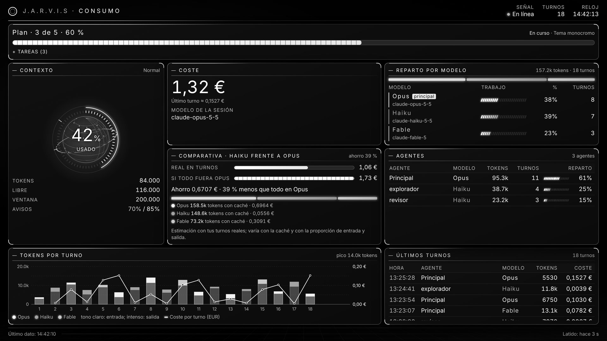
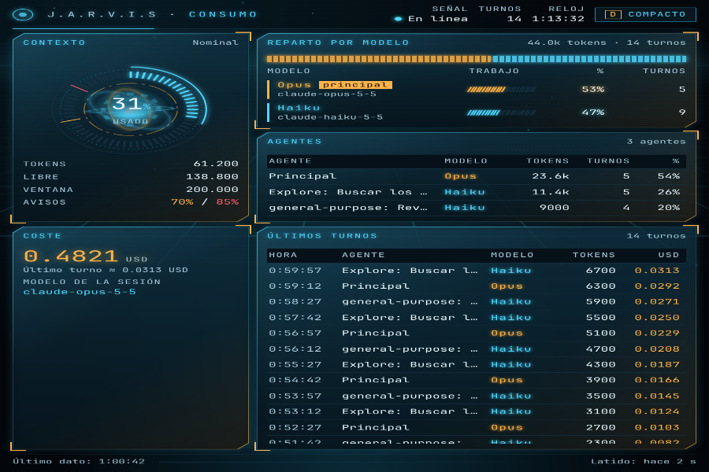
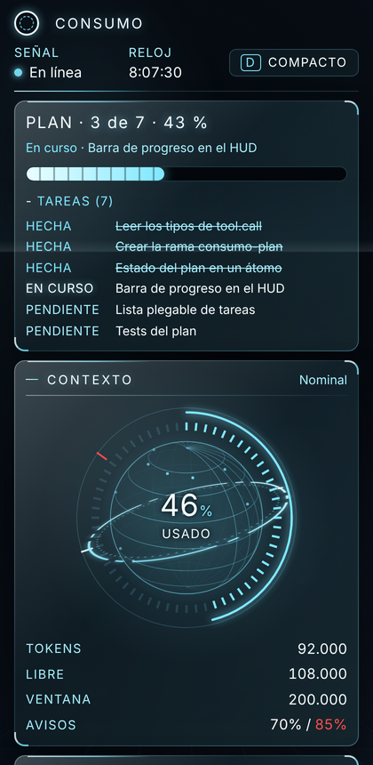
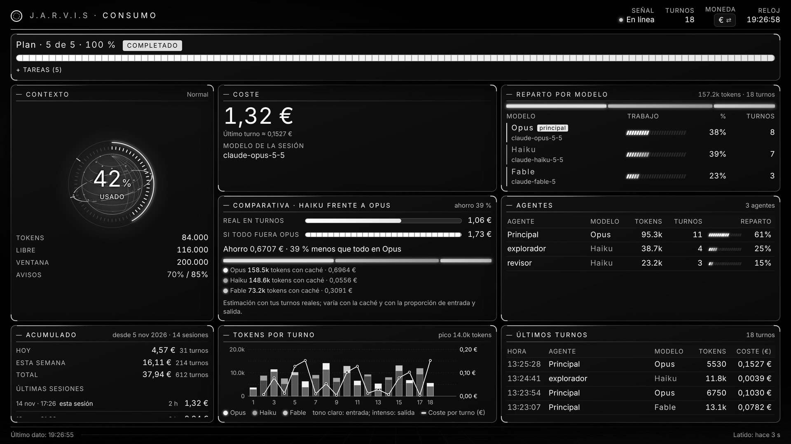
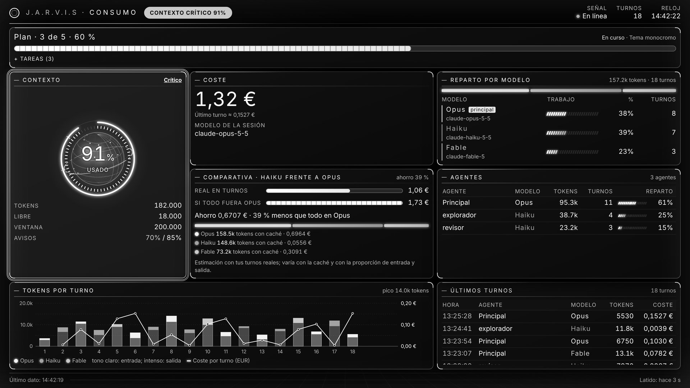
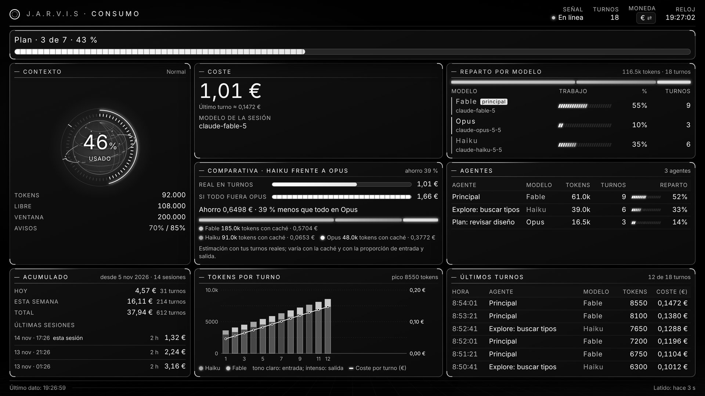
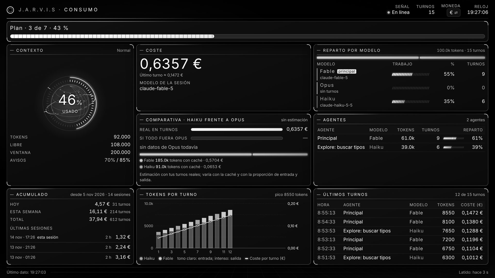
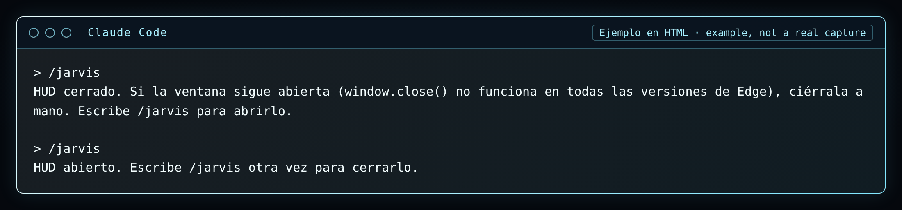

<a id="es"></a>

# consumo

**Español** · [English](#en)

Abre una ventana HUD en directo con lo que gasta la sesión: contexto, coste y tokens. Estética blanco-cian sobre fondo azul-negro, con la barra del plan arriba y una comparativa de Haiku frente a Opus. El comando `/jarvis` abre o cierra el HUD.



## Qué hace

- Al iniciar la sesión abre una ventana aparte con Edge o Chrome en modo aplicación (`--app`).
- Arriba, una barra de progreso del plan de Claude (las tareas que crea y actualiza), con la lista plegable.
- Contexto usado y su porcentaje, coste acumulado y tokens por agente y por modelo.
- Reparto del trabajo entre modelos, gráfica de tokens por turno y los últimos 20 turnos.
- **Comparativa Haiku frente a Opus:** lo que costó la sesión y lo que habría costado si el trabajo enviado a Haiku hubiera ido a Opus, con el coste por token de tus propios turnos. Muestra el ahorro en USD y en %. Necesita más de 1000 tokens de cada modelo; si no, pone "sin datos de Opus todavía" (o de Haiku) y no estima nada.
- **Comando `/jarvis`:** abre el HUD si está cerrado y lo cierra si está abierto.
- Avisa cuando el contexto pasa del **70 %** y del **85 %**: por encima del 85 % el HUD entero pasa a rojo de alerta.
- Si los datos dejan de llegar 10 segundos, marca "sin señal".
- Funciona sin conexión: todo va dentro de la página.
- La tecla `D` (o el botón de la cabecera) cambia entre modo cómodo y compacto. La elección se recuerda.

Se adapta al tamaño de la ventana:

| Ancho | Diseño |
|---|---|
| 1600 px o más | rejilla completa, con la gráfica de tokens por turno |
| 900 a 1599 px | dos columnas, sin la gráfica |
| menos de 900 px | una columna; funciona desde 420 px sin desplazamiento horizontal |

| 900 × 600 | 420 × 860 |
|---|---|
|  |  |

| Plan completo | Contexto crítico |
|---|---|
|  |  |

| Comparativa con Haiku y Opus | Comparativa sin datos de Opus |
|---|---|
|  |  |

*Capturas con datos de ejemplo.*

## Comparativa Haiku frente a Opus

- **Real:** la suma del coste de los turnos de la sesión.
- **Todo en Opus:** el coste real, cambiando lo que costó Haiku por sus tokens al precio por token que ha tenido Opus en tus turnos.
- **Ahorro:** la diferencia, en USD y en %.
- Debajo, los tokens y el coste de cada modelo (Fable, Haiku, Opus…).
- Es una estimación: el caché y la mezcla de entrada y salida cambian el precio real por token. Un turno sin coste conocido no cuenta para el precio por token.

## Comando /jarvis



`/jarvis` abre o cierra el HUD:

- Si el HUD está cerrado, lo abre como al iniciar la sesión (Edge o Chrome con `--app`).
- Si está abierto, lo cierra. El mod no cierra la ventana del navegador por su cuenta, porque tendría que matar procesos de Edge que no son suyos. En su lugar escribe `estado.json` en la [carpeta de datos](#es-carpeta) con `{"abierto": false}` (y `{"abierto": true}` antes de abrir). La página lo lee cada segundo y, al ver `abierto: false`, llama a `window.close()`.
- Si `window.close()` no cierra la ventana, la página muestra "HUD cerrado. Escribe /jarvis para abrirlo." **`window.close()` puede no funcionar en todas las versiones de Edge: en ese caso cierra la ventana a mano.**
- Si no hay navegador, `/jarvis` lo dice y te indica la ruta de `index.html` para que lo abras a mano.

El mod no tiene comando `/consumo`: `/jarvis` es su único comando.

## Cómo funciona

1. **Al iniciar la sesión** registra `/jarvis`, escribe la página `index.html` en la carpeta de datos y la abre con Edge (o Chrome si no hay Edge).
2. Escucha los eventos de **turno terminado**, **herramienta** y **subagente** (`turn.complete`, `tool.call`, `agent.spawn`).
3. En cada turno suma los tokens de entrada, salida y caché por agente y por modelo, y guarda los últimos 20 turnos. Un turno repetido no se cuenta dos veces.
4. El **coste** sale del contador de la propia sesión: el coste de un turno es lo que sube ese contador. No usa tabla de precios.
5. Las llamadas a `TaskCreate` y `TaskUpdate` alimentan la barra del plan.
6. Todo se escribe en `datos.js` (en la carpeta de datos) tras cada turno o herramienta, y además cada 3 segundos como latido.
7. **La página recarga `datos.js` cada segundo** y redibuja. Si en 10 segundos no llega un latido nuevo, muestra "sin señal".
8. La página también carga `estado.js` cada segundo. Es una copia de `estado.json` en forma de script, porque el navegador no deja leer un `.json` desde `file://`.

Archivos que crea en tu PC, todos en la carpeta de datos: `index.html` (la página), `datos.js` (los datos), `estado.json` y `estado.js` (si el HUD está abierto).

## Cómo se instala

```
/plugin marketplace add deriva1945-ui/portero-claude
/plugin install consumo@jarvis-essential-pack
```

O cárgalo con `--plugin-dir` (ver el [README principal](../README.md#es-cargar)).

Requisitos: Windows con Edge o Chrome.

<a id="es-carpeta"></a>

## Carpeta de datos

La opción **`dataDir`** dice dónde se escriben `index.html`, `datos.js`, `estado.json` y `estado.js`.

- **Valor por defecto:** `~/CLAUDE/consumo`. `~` es tu carpeta de usuario: `%USERPROFILE%` en Windows (por ejemplo `C:\Users\<tú>\CLAUDE\consumo`), `$HOME` en macOS y Linux.
- Acepta una ruta absoluta o una que empiece por `~`. Una ruta relativa cuenta desde tu carpeta de usuario.
- La carpeta se crea sola si no existe.
- Si el mod no sabe cuál es tu carpeta de usuario (ni `USERPROFILE` ni `HOME`), usa la carpeta `datos` dentro del propio plugin.

Para cambiarla en un mod instalado:

```
claude plugin configure consumo@jarvis-essential-pack
```

Sin más argumentos muestra las opciones y su valor. Para guardar un valor nuevo, pásalo en JSON por la entrada estándar (en Windows usa `/` o dobla las `\\` dentro del JSON):

```
echo '{"dataDir": "~/CLAUDE/consumo"}' | claude plugin configure consumo@jarvis-essential-pack --values-stdin
```

También puedes cambiarla dentro de Claude Code con `/plugin configure consumo@jarvis-essential-pack` o en `/config`. Si cargas el mod con `--plugin-dir`, guarda el valor en `~/.claude/settings.json`:

```json
{ "pluginConfigs": { "consumo": { "options": { "dataDir": "~/CLAUDE/consumo" } } } }
```

El cambio se aplica al reiniciar Claude Code.

## Personalización

Además de `dataDir`, el HUD tiene estas opciones. Todas van a `datos.js` en el campo `config` (ya validadas), y la página las lee de ahí.

| Opción | Valores | Por defecto | Qué cambia |
| --- | --- | --- | --- |
| `tema` | `mark-ii`, `mark-l`, `stark`, `hibrido`, `claro` | `hibrido` | Tema de color del HUD. |
| `acento` | color hex: `#rgb` o `#rrggbb` | `#7fe7ff` | Color de acento. |
| `densidad` | `comodo`, `compacto` | `comodo` | Espaciado de los paneles. |
| `idioma` | `es`, `en` | `es` | Idioma de los textos del HUD. |
| `actualizacion` | número de segundos, de 1 a 5 | `1` | Cada cuánto la página vuelve a leer `datos.js`. |
| `paneles` | lista con `contexto`, `coste`, `reparto`, `agentes`, `historial`, `grafica`, `comparativa`, `plan` | todos | Paneles visibles (se muestran siempre en el orden del HUD). |

Valores que no valen:

- Si `acento` no es un color hex o `actualizacion` está fuera de 1–5, se usa el valor por defecto y queda un aviso en el log (`consumo: ...`) al empezar la sesión.
- En `paneles`, los nombres desconocidos se ignoran con un aviso; si no queda ninguno válido se muestran todos.
- `tema`, `densidad` e `idioma` solo aceptan los valores de la tabla; Claude Code trata cualquier otro como no puesto y aplica el defecto.

Para cambiarlas en un mod instalado:

```
claude plugin configure consumo@jarvis-essential-pack
```

O en una sola línea, por la entrada estándar:

```
echo '{"tema": "stark", "acento": "#ff8a00", "densidad": "compacto", "idioma": "en", "actualizacion": 2, "paneles": ["contexto", "coste", "plan"]}' | claude plugin configure consumo@jarvis-essential-pack --values-stdin
```

También aparecen en `/config` dentro de Claude Code. Si cargas el mod con `--plugin-dir`, ponlas en `~/.claude/settings.json`:

```json
{
  "pluginConfigs": {
    "consumo": {
      "options": {
        "tema": "stark",
        "acento": "#ff8a00",
        "densidad": "compacto",
        "idioma": "en",
        "actualizacion": 2,
        "paneles": ["contexto", "coste", "plan"]
      }
    }
  }
}
```

## Qué no hace / límites

- Abrir la ventana solo funciona en Windows: usa `cmd /c start` con Edge o Chrome. En otros sistemas los datos se escriben igual en la carpeta de datos y puedes abrir `index.html` a mano.
- No se ha probado en todos los PC. Puede variar con la versión de Windows, el navegador o el escalado de pantalla.
- Sin navegador no abre la ventana. Los datos se siguen guardando y puedes abrir la página a mano.
- `/jarvis` no puede forzar el cierre: si `window.close()` no funciona en tu Edge, cierra la ventana a mano.
- La comparativa es una estimación, no una factura.
- El coste por turno es aproximado cuando hay varios agentes a la vez.

## Licencia

MIT © deriva1945-ui. Ver [LICENSE](LICENSE).

---

<a id="en"></a>

# consumo (English)

[Español](#es) · **English**

Opens a live HUD window with what the session spends: context, cost and tokens. White-cyan look on a blue-black background, with the plan bar at the top and a Haiku versus Opus comparison. The `/jarvis` command opens or closes the HUD.


## What it does

- When the session starts, it opens a separate window with Edge or Chrome in app mode (`--app`).
- At the top, a progress bar for Claude's plan (the tasks it creates and updates), with a collapsible list.
- Context used and its percentage, total cost, and tokens per agent and per model.
- How work is split between models, a tokens-per-turn chart, and the last 20 turns.
- **Haiku versus Opus comparison:** what the session cost and what it would have cost if the work sent to Haiku had gone to Opus, using the cost per token of your own turns. It shows the saving in USD and %. It needs more than 1000 tokens from each model; otherwise it shows "sin datos de Opus todavía" (no Opus data yet, or Haiku) and estimates nothing.
- **`/jarvis` command:** opens the HUD when it is closed and closes it when it is open.
- It warns when context goes over **70 %** and **85 %**: above 85 % the whole HUD turns alert red.
- If data stops arriving for 10 seconds, it shows "sin señal" (no signal).
- It works offline: everything is inside the page.
- The `D` key (or the header button) switches between comfortable and compact mode. The choice is remembered.

It adapts to the window size:

| Width | Layout |
|---|---|
| 1600 px or more | full grid, with the tokens-per-turn chart |
| 900 to 1599 px | two columns, without the chart |
| under 900 px | one column; works from 420 px with no horizontal scroll |

| 900 × 600 | 420 × 860 |
|---|---|
|  |  |

| Plan complete | Critical context |
|---|---|
|  |  |

| Comparison with Haiku and Opus | Comparison without Opus data |
|---|---|
|  |  |

*Screenshots with sample data.*

## Haiku versus Opus comparison

- **Real (Real):** the sum of the session's turn costs.
- **All on Opus (Todo en Opus):** the real cost, with what Haiku cost replaced by its tokens at the per-token price Opus had in your turns.
- **Saving (Ahorro):** the difference, in USD and %.
- Below, the tokens and cost of each model (Fable, Haiku, Opus…).
- It is an estimate: cache and the mix of input and output change the real price per token. A turn with no known cost does not count toward the price per token.

## The /jarvis command


`/jarvis` opens or closes the HUD:

- If the HUD is closed, it opens it the same way as at session start (Edge or Chrome with `--app`).
- If it is open, it closes it. The mod does not close the browser window itself, because that would mean killing Edge processes it does not own. Instead it writes `estado.json` in the [data folder](#en-folder) with `{"abierto": false}` (and `{"abierto": true}` before opening). The page reads it every second and, when it sees `abierto: false`, calls `window.close()`.
- If `window.close()` does not close the window, the page shows "HUD cerrado. Escribe /jarvis para abrirlo." (HUD closed. Type /jarvis to open it.) **`window.close()` may not work in every Edge version: in that case close the window by hand.**
- With no browser, `/jarvis` says so and gives you the path of `index.html` so you can open it by hand.

The mod has no `/consumo` command: `/jarvis` is its only command.

## How it works

1. **When the session starts** it registers `/jarvis`, writes the page `index.html` in the data folder and opens it with Edge (or Chrome if Edge is missing).
2. It listens to the **turn ended**, **tool** and **subagent** events (`turn.complete`, `tool.call`, `agent.spawn`).
3. On each turn it adds up input, output and cache tokens per agent and per model, and keeps the last 20 turns. A repeated turn is not counted twice.
4. **Cost** comes from the session's own counter: a turn's cost is how much that counter went up. No price table.
5. Calls to `TaskCreate` and `TaskUpdate` feed the plan bar.
6. Everything is written to `datos.js` (in the data folder) after each turn or tool, and every 3 seconds as a heartbeat.
7. **The page reloads `datos.js` every second** and redraws. If no new heartbeat arrives in 10 seconds, it shows "sin señal".
8. The page also loads `estado.js` every second. It is a script copy of `estado.json`, because the browser does not let a page read a `.json` file from `file://`.

Files it creates on your PC, all in the data folder: `index.html` (the page), `datos.js` (the data), `estado.json` and `estado.js` (whether the HUD is open).

## Install

```
/plugin marketplace add deriva1945-ui/portero-claude
/plugin install consumo@jarvis-essential-pack
```

Or load it with `--plugin-dir` (see the [main README](../README.md#en-load)).

Requirements: Windows with Edge or Chrome.

<a id="en-folder"></a>

## Data folder

The **`dataDir`** option sets where `index.html`, `datos.js`, `estado.json` and `estado.js` are written.

- **Default:** `~/CLAUDE/consumo`. `~` is your user folder: `%USERPROFILE%` on Windows (for example `C:\Users\<you>\CLAUDE\consumo`), `$HOME` on macOS and Linux.
- It takes an absolute path or one starting with `~`. A relative path counts from your user folder.
- The folder is created if it does not exist.
- If the mod cannot tell your user folder (neither `USERPROFILE` nor `HOME` is set), it uses the `datos` folder inside the plugin itself.

To change it for an installed mod:

```
claude plugin configure consumo@jarvis-essential-pack
```

With no other arguments it shows the options and their values. To save a new value, pass it as JSON on standard input (on Windows use `/`, or double the `\\` inside the JSON):

```
echo '{"dataDir": "~/CLAUDE/consumo"}' | claude plugin configure consumo@jarvis-essential-pack --values-stdin
```

You can also change it inside Claude Code with `/plugin configure consumo@jarvis-essential-pack` or in `/config`. If you load the mod with `--plugin-dir`, save the value in `~/.claude/settings.json`:

```json
{ "pluginConfigs": { "consumo": { "options": { "dataDir": "~/CLAUDE/consumo" } } } }
```

The change applies when you restart Claude Code.

## Customisation

Besides `dataDir`, the HUD has these options. All of them go into `datos.js` under the `config` field (already validated), and the page reads them from there.

| Option | Values | Default | What it changes |
| --- | --- | --- | --- |
| `tema` | `mark-ii`, `mark-l`, `stark`, `hibrido` (hybrid), `claro` (light) | `hibrido` | HUD colour theme. |
| `acento` | hex colour: `#rgb` or `#rrggbb` | `#7fe7ff` | Accent colour. |
| `densidad` | `comodo` (comfortable), `compacto` (compact) | `comodo` | Panel spacing. |
| `idioma` | `es`, `en` | `es` | Language of the HUD labels. |
| `actualizacion` | number of seconds, 1 to 5 | `1` | How often the page re-reads `datos.js`. |
| `paneles` | list of `contexto`, `coste`, `reparto`, `agentes`, `historial`, `grafica`, `comparativa`, `plan` | all | Visible panels (always shown in the HUD's own order). |

Invalid values:

- If `acento` is not a hex colour or `actualizacion` is outside 1–5, the default is used and a warning (`consumo: ...`) is logged when the session starts.
- In `paneles`, unknown names are ignored with a warning; if none is valid, every panel is shown.
- `tema`, `densidad` and `idioma` only take the values in the table; Claude Code treats any other value as unset and applies the default.

To change them in an installed mod:

```
claude plugin configure consumo@jarvis-essential-pack
```

Or in one line, through standard input:

```
echo '{"tema": "stark", "acento": "#ff8a00", "densidad": "compacto", "idioma": "en", "actualizacion": 2, "paneles": ["contexto", "coste", "plan"]}' | claude plugin configure consumo@jarvis-essential-pack --values-stdin
```

They also show up in `/config` inside Claude Code. If you load the mod with `--plugin-dir`, put them in `~/.claude/settings.json`:

```json
{
  "pluginConfigs": {
    "consumo": {
      "options": {
        "tema": "stark",
        "acento": "#ff8a00",
        "densidad": "compacto",
        "idioma": "en",
        "actualizacion": 2,
        "paneles": ["contexto", "coste", "plan"]
      }
    }
  }
}
```

## What it does not do / limits

- Opening the window only works on Windows: it uses `cmd /c start` with Edge or Chrome. On other systems the data is still written to the data folder and you can open `index.html` by hand.
- It has not been tested on every PC. It may vary with the Windows version, the browser or display scaling.
- With no browser, it does not open the window. Data is still saved and you can open the page by hand.
- `/jarvis` cannot force the window shut: if `window.close()` does not work in your Edge, close the window by hand.
- The comparison is an estimate, not a bill.
- Cost per turn is approximate when several agents run at once.

## License

MIT © deriva1945-ui. See [LICENSE](LICENSE).
