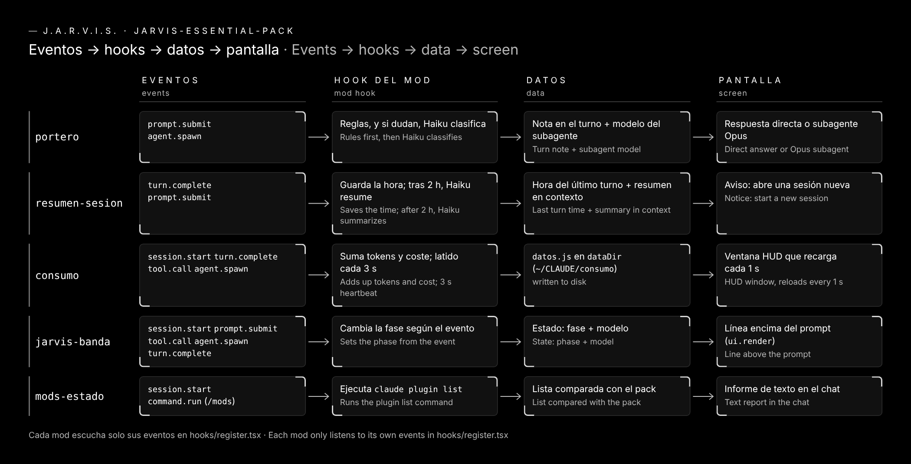

# Cómo funciona por dentro

**Español** · [English](how-it-works.md) · [← Volver al README](../README.md)

Los cinco mods siguen el mismo camino: **eventos → hooks → datos → pantalla**.

## Las cuatro piezas

| Pieza | Qué es |
|---|---|
| **Eventos** | Claude Code avisa de lo que pasa: `session.start` (empieza la sesión), `prompt.submit` (envías un mensaje), `tool.call` (corre una herramienta), `agent.spawn` (nace un subagente), `turn.complete` (termina un turno), `ui.render` (se dibuja una zona de la pantalla) y `command.run` (escribes un comando del mod). |
| **Hooks** | Cada mod tiene un archivo `hooks/register.tsx`. Ahí dice qué eventos escucha y qué hace con cada uno. |
| **Datos** | Lo que el mod recuerda entre eventos. Es pequeño: una hora, unos contadores, una fase. `consumo` además escribe un archivo en disco. |
| **Pantalla** | Donde se ve el resultado: una línea, un aviso, una ventana HUD, un texto en el chat o el propio turno de Claude. |

## Mod a mod

| Mod | Escucha | Guarda | Muestra |
|---|---|---|---|
| [portero](../portero/) | `prompt.submit`, `agent.spawn` | la ruta del turno (ligera o pesada) | una nota en el turno y, si es pesada, un subagente Opus |
| [resumen-sesion](../resumen-sesion/) | `turn.complete`, `prompt.submit` | la hora del último turno | un resumen de Haiku en el contexto y un aviso |
| [consumo](../consumo/) | `session.start`, `turn.complete`, `tool.call`, `agent.spawn`, `command.run` | tokens, coste, turnos, plan, comparativa Haiku/Opus y si el HUD está abierto; va a `datos.js` y `estado.js` | una ventana HUD que recarga `datos.js` cada segundo y la respuesta de `/jarvis` |
| [jarvis-banda](../jarvis-banda/) | `session.start`, `prompt.submit`, `tool.call`, `agent.spawn`, `turn.complete`, `ui.render` | fase, herramienta y modelos | una línea encima del prompt |
| [mods-estado](../mods-estado/) | `session.start`, `command.run` | nada: lo calcula al momento | el informe de `/mods` y la respuesta de `/mods on` y `/mods off` |

## Reglas que cumplen todos

- **No rompen la sesión.** Si un mod falla, deja pasar el evento sin cambios.
- **Solo escuchan lo que necesitan.** Un mod no ve los eventos que no pide.
- **No guardan tu conversación.** Lo único que se escribe en disco son los archivos de `consumo` en `C:\CLAUDE\consumo`: la página, `datos.js` (números, nombres de modelo, la descripción corta de cada subagente y los títulos de tareas del plan) y `estado.json` / `estado.js` (si el HUD está abierto).
