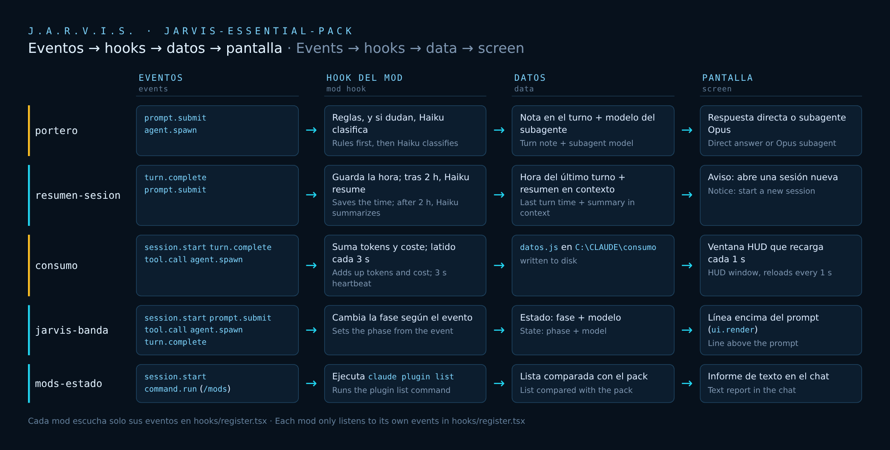

# How it works inside

[Español](como-funciona.md) · **English** · [← Back to the README](../README.md#en)

All five mods follow the same path: **events → hooks → data → screen**.

## The four pieces

| Piece | What it is |
|---|---|
| **Events** | Claude Code reports what happens: `session.start` (the session starts), `prompt.submit` (you send a message), `tool.call` (a tool runs), `agent.spawn` (a subagent starts), `turn.complete` (a turn ends), `ui.render` (an area of the screen is drawn) and `command.run` (you type one of the mod's commands). |
| **Hooks** | Each mod has a `hooks/register.tsx` file. It says which events the mod listens to and what it does with each one. |
| **Data** | What the mod remembers between events. It is small: a time, a few counters, a phase. `consumo` also writes a file to disk. |
| **Screen** | Where you see the result: a line, a notice, a HUD window, a text in the chat, or Claude's own turn. |

## Mod by mod

| Mod | Listens to | Keeps | Shows |
|---|---|---|---|
| [portero](../portero/) | `prompt.submit`, `agent.spawn` | the turn's route (light or heavy) | a note in the turn and, if heavy, an Opus subagent |
| [resumen-sesion](../resumen-sesion/) | `turn.complete`, `prompt.submit` | the time of the last turn | a Haiku summary in context and a notice |
| [consumo](../consumo/) | `session.start`, `turn.complete`, `tool.call`, `agent.spawn` | tokens, cost, turns and plan; all written to `datos.js` | a HUD window that reloads `datos.js` every second |
| [jarvis-banda](../jarvis-banda/) | `session.start`, `prompt.submit`, `tool.call`, `agent.spawn`, `turn.complete`, `ui.render` | phase, tool and models | a line above the prompt |
| [mods-estado](../mods-estado/) | `session.start`, `command.run` | nothing: it works it out on the spot | the `/mods` report |

## Rules they all follow

- **They do not break the session.** If a mod fails, it lets the event through unchanged.
- **They only listen to what they need.** A mod does not see events it does not ask for.
- **They do not store your conversation.** The only thing written to disk is `consumo`'s `datos.js` (numbers, model names, each subagent's short description and plan task titles).
