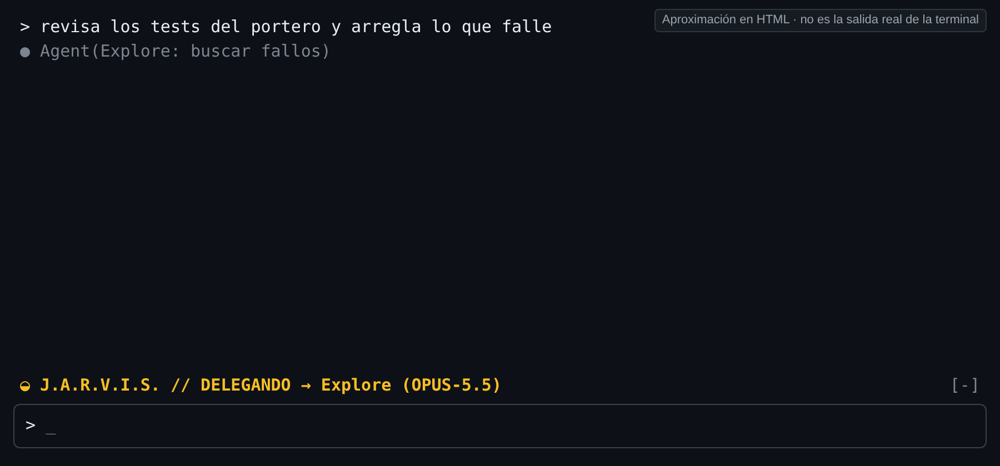
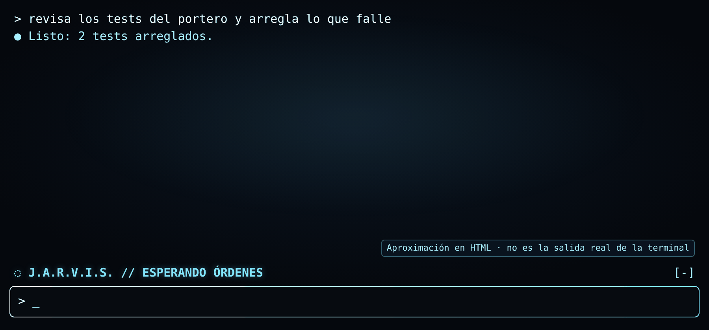
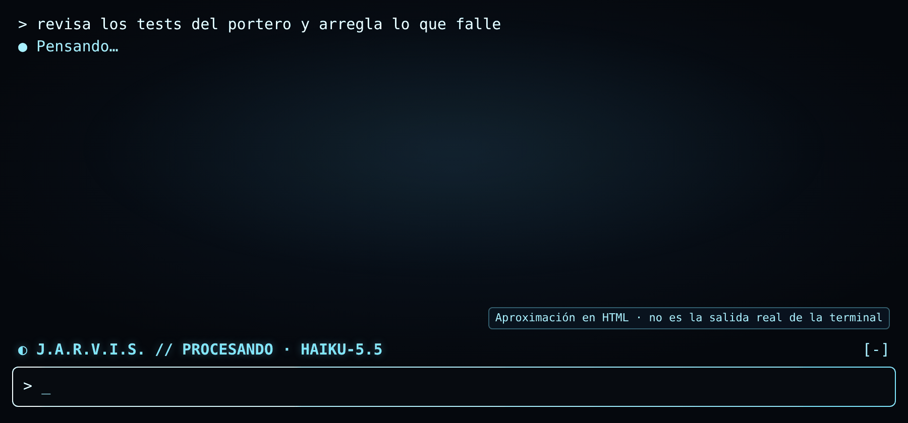
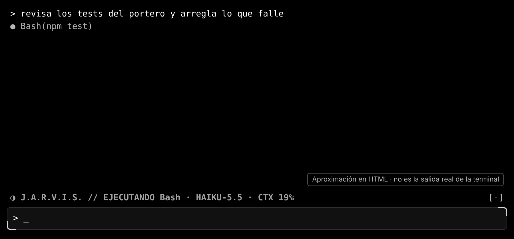

<a id="es"></a>

# jarvis-banda

**Español** · [English](#en)

Dibuja una línea estilo J.A.R.V.I.S. encima del prompt con el estado en vivo de la sesión.



*Aproximación en HTML, no es la salida real de la terminal.*

## Qué hace

Una sola línea que cambia con lo que pasa en la sesión:

| Símbolo | Estado | Cuándo |
|---|---|---|
| ◌ | ESPERANDO ÓRDENES | al empezar la sesión y al terminar cada turno |
| ◐ | PROCESANDO · modelo | al enviar un mensaje, y al terminar una herramienta o subagente |
| ◑ | EJECUTANDO herramienta | mientras corre una herramienta (Bash, Edit…) |
| ◒ | DELEGANDO → tipo (modelo) | al lanzar un subagente |

El color depende del modelo: Haiku cian, Opus ámbar, Fable violeta, otros blanco azulado. Al delegar, toma el color del modelo del subagente.

| Esperando | Procesando | Ejecutando |
|---|---|---|
|  |  |  |

## Cómo funciona

1. Guarda un estado pequeño: fase, herramienta o subagente, modelo de la sesión y modelo del subagente.
2. Cada evento cambia la fase:
   - `session.start` y fin de turno → esperando.
   - `prompt.submit` → procesando (lee el modelo de la sesión).
   - `tool.call` → ejecutando mientras corre; al acabar, vuelve a procesando.
   - `agent.spawn` → delegando, con el tipo y el modelo del subagente.
3. Las herramientas que usan los subagentes no cambian la línea: manda la delegación.
4. Al dibujar la zona de **encima del prompt** (`ui.render`, `AbovePrompt`), lee el estado y pinta una línea con símbolo, texto y color.
5. **Se redibuja solo cuando hay un evento.** No usa temporizadores.

## Cómo se instala

```
/plugin marketplace add deriva1945-ui/portero-claude
/plugin install jarvis-banda@jarvis-essential-pack
```

O cárgalo con `--plugin-dir` (ver el [README principal](../README.md#es-cargar)).

## Qué no hace / límites

- No muestra coste ni contexto: eso está en el mod [consumo](../consumo/).
- No toca la línea de estado ni muestra avisos.
- Si algo falla al leer el estado, la línea desaparece y el prompt sigue normal.
- No se ha probado dentro de todas las terminales de Windows.

## Licencia

MIT © deriva1945-ui. Ver [LICENSE](LICENSE).

---

<a id="en"></a>

# jarvis-banda (English)

[Español](#es) · **English**

Draws one J.A.R.V.I.S.-style line above the prompt with the session's live state.


*HTML approximation, not the real terminal output.*

## What it does

One line that changes with what happens in the session (labels are in Spanish):

| Symbol | State | When |
|---|---|---|
| ◌ | ESPERANDO ÓRDENES (awaiting orders) | when the session starts and after each turn |
| ◐ | PROCESANDO · model (processing) | when you send a message, and after a tool or subagent ends |
| ◑ | EJECUTANDO tool (running) | while a tool runs (Bash, Edit…) |
| ◒ | DELEGANDO → type (model) (delegating) | when a subagent starts |

The color depends on the model: Haiku cyan, Opus amber, Fable violet, others bluish white. While delegating, it uses the subagent's model color.

| Waiting | Processing | Running |
|---|---|---|
|  |  |  |

## How it works

1. It keeps a small state: phase, tool or subagent, session model and subagent model.
2. Each event changes the phase:
   - `session.start` and end of turn → waiting.
   - `prompt.submit` → processing (reads the session model).
   - `tool.call` → running while it runs; when it ends, back to processing.
   - `agent.spawn` → delegating, with the subagent's type and model.
3. Tools used by subagents do not change the line: delegation wins.
4. When the area **above the prompt** is drawn (`ui.render`, `AbovePrompt`), it reads the state and paints one line with symbol, text and color.
5. **It only redraws when an event happens.** No timers.

## Install

```
/plugin marketplace add deriva1945-ui/portero-claude
/plugin install jarvis-banda@jarvis-essential-pack
```

Or load it with `--plugin-dir` (see the [main README](../README.md#en-load)).

## What it does not do / limits

- It does not show cost or context: that is the [consumo](../consumo/) mod.
- It does not touch the status line or show notices.
- If reading the state fails, the line disappears and the prompt works as usual.
- It has not been tested in every Windows terminal.

## License

MIT © deriva1945-ui. See [LICENSE](LICENSE).
