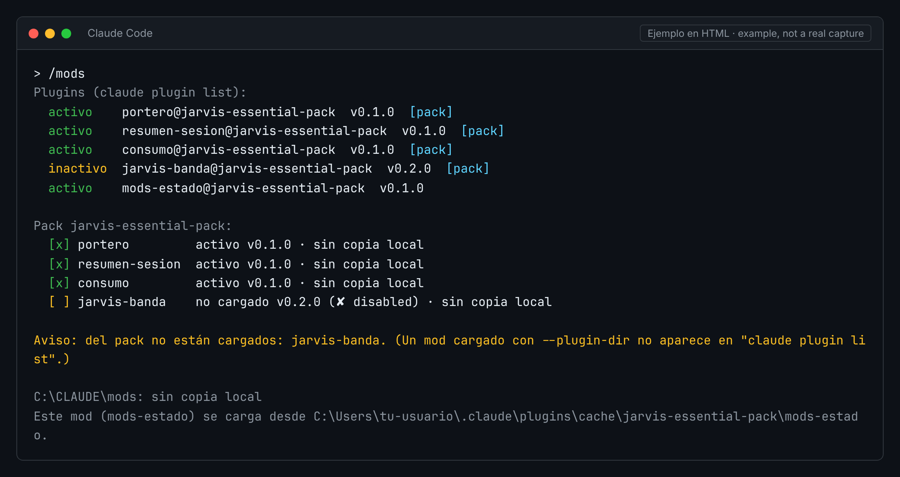

# mods-estado

**Español** · [English](#english)

Mod para Claude Code que añade el comando `/mods`. Te dice qué plugins están activos y cuáles del pack faltan.



*Ejemplo en HTML, no es una captura real.*

## Qué hace

- Ejecuta `claude plugin list` y resume la salida: estado, nombre, origen y versión de cada plugin. Marca con `[pack]` los del pack.
- Muestra una tabla del pack: `[x]` activo, `[ ]` no cargado o no instalado, `[?]` si no pudo leer la lista.
- Mira si existe la carpeta `C:\CLAUDE\mods` y qué mods del pack tienen copia allí.
- Si `claude` no está en el PATH o el comando falla, lo dice en vez de romperse.

## Instalación

```
/plugin marketplace add deriva1945-ui/portero-claude
/plugin install mods-estado@jarvis-essential-pack
```

Luego escribe `/mods` en Claude Code.

## Qué no hace

- No ve los mods cargados con `--plugin-dir`. Esos salen como "no cargado" aunque estén en uso.
- No activa ni instala nada: solo informa.
- La carpeta `C:\CLAUDE\mods` es una ruta de Windows. En otros sistemas sale "sin copia local".

## Licencia

MIT. Ver [LICENSE](LICENSE).

---

<a id="english"></a>

# mods-estado (English)

A Claude Code mod that adds the `/mods` command. It tells you which plugins are active and which ones from the pack are missing.


*HTML example, not a real screenshot. The output is in Spanish.*

## What it does

- Runs `claude plugin list` and summarizes it: state, name, source and version of each plugin. Pack plugins get a `[pack]` tag.
- Shows a pack table: `[x]` active, `[ ]` not loaded or not installed, `[?]` if the list could not be read.
- Checks whether the `C:\CLAUDE\mods` folder exists and which pack mods have a copy there.
- If `claude` is not on the PATH or the command fails, it says so instead of breaking.

## Install

```
/plugin marketplace add deriva1945-ui/portero-claude
/plugin install mods-estado@jarvis-essential-pack
```

Then type `/mods` in Claude Code.

## What it does not do

- It cannot see mods loaded with `--plugin-dir`. Those show as "not loaded" even when in use.
- It does not enable or install anything: it only reports.
- `C:\CLAUDE\mods` is a Windows path. On other systems it shows "sin copia local" (no local copy).

## License

MIT. See [LICENSE](LICENSE).
