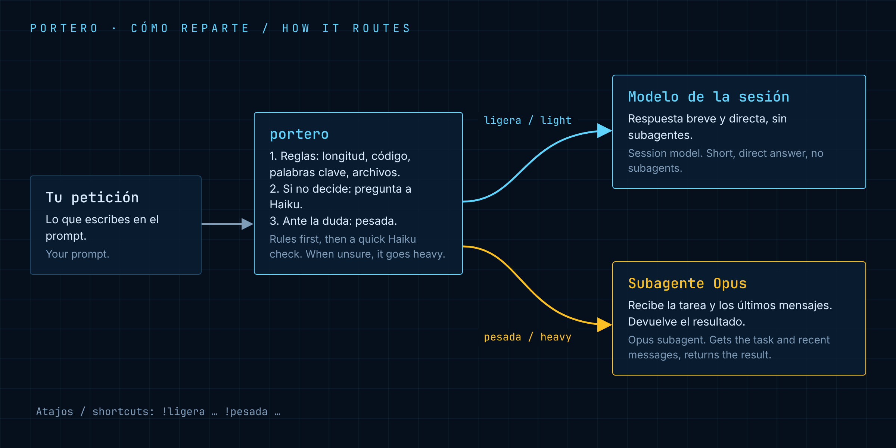

<a id="es"></a>

# portero

**Español** · [English](#en)

Mira cada petición antes de responder y decide quién la hace: el modelo de la sesión o un subagente potente.



## Qué hace

| Ruta | Ejemplos | Quién responde |
|---|---|---|
| **Ligera** | traducir, dar formato, preguntas cortas | el modelo de la sesión, sin subagentes |
| **Pesada** | arquitectura, depurar, analizar, varios archivos | un subagente con Opus, con los últimos mensajes como contexto |
| **Dudosa** | lo que no está claro | va por la ruta pesada |

Atajos para decidir tú:

- `!pesada ...` fuerza la ruta pesada.
- `!ligera ...` fuerza la ruta ligera.

## Cómo funciona

1. Escucha el evento de **mensaje enviado** (`prompt.submit`). Los comandos y mensajes vacíos pasan sin tocar.
2. **Reglas primero.** Si el texto pasa de 600 caracteres, lleva un bloque de código, nombra un archivo (`.ts`, `.py`…) o usa palabras como "depura", "refactor" o "analiza", es pesada. Si es corto (menos de 200 caracteres) y empieza por "traduce", "formatea", "qué es"…, es ligera.
3. **Modelo ligero después.** Si las reglas no deciden, pregunta a Haiku: ligera, pesada o dudosa. Si Haiku duda o falla, elige pesada.
4. **Ligera:** añade una nota al turno ("respuesta breve, sin subagentes") y lo responde el modelo de la sesión.
5. **Pesada:** añade una nota que pide delegar la tarea con la herramienta Agent, junto con los últimos 4 mensajes como contexto.
6. Cuando nace ese subagente (`agent.spawn`), portero le pone el modelo potente (`opus`) si nadie eligió otro.
7. La línea de estado muestra la ruta: `portero: ligera → modelo de la sesión` o `portero: pesada → opus`.

Para usar otro modelo en lo pesado, cambia `HEAVY_MODEL` en [`hooks/register.tsx`](hooks/register.tsx) (`opus` o `fable`).

## Cómo se instala

```
/plugin marketplace add deriva1945-ui/portero-claude
/plugin install portero@jarvis-essential-pack
```

O cárgalo con `--plugin-dir` (ver el [README principal](../README.md#es-cargar)).

## Qué no hace / límites

- No cambia el modelo del hilo principal. Si la sesión usa Opus, lo ligero también va con Opus. Para ahorrar, pon la sesión en Haiku con `/model`.
- El subagente solo ve los últimos 4 mensajes, no todo el historial.
- La clasificación puede fallar. Si no estás de acuerdo, usa los atajos.
- Cada petición dudosa cuesta una consulta corta a Haiku.

## Licencia

MIT © deriva1945-ui. Ver [LICENSE](LICENSE).

---

<a id="en"></a>

# portero (English)

[Español](#es) · **English**

Looks at each request before answering and decides who handles it: the session model or a powerful subagent.


## What it does

| Route | Examples | Who answers |
|---|---|---|
| **Light** | translate, format, short questions | the session model, with no subagents |
| **Heavy** | architecture, debugging, analysis, several files | an Opus subagent, with the latest messages as context |
| **Unsure** | anything unclear | takes the heavy route |

Shortcuts to decide yourself:

- `!pesada ...` forces the heavy route.
- `!ligera ...` forces the light route.

## How it works

1. It listens to the **message sent** event (`prompt.submit`). Commands and empty messages pass through untouched.
2. **Rules first.** If the text is over 600 characters, has a code block, names a file (`.ts`, `.py`…) or uses words like "debug", "refactor" or "analiza", it is heavy. If it is short (under 200 characters) and starts with "translate", "traduce", "qué es"…, it is light.
3. **Light model next.** If the rules cannot decide, it asks Haiku: light, heavy or unsure. If Haiku is unsure or fails, it picks heavy.
4. **Light:** it adds a note to the turn ("short answer, no subagents") and the session model answers.
5. **Heavy:** it adds a note asking to delegate the task with the Agent tool, plus the last 4 messages as context.
6. When that subagent starts (`agent.spawn`), portero gives it the powerful model (`opus`) if no one chose another.
7. The status line shows the route: `portero: ligera → modelo de la sesión` or `portero: pesada → opus`.

To use another model for heavy work, change `HEAVY_MODEL` in [`hooks/register.tsx`](hooks/register.tsx) (`opus` or `fable`).

## Install

```
/plugin marketplace add deriva1945-ui/portero-claude
/plugin install portero@jarvis-essential-pack
```

Or load it with `--plugin-dir` (see the [main README](../README.md#en-load)).

## What it does not do / limits

- It does not change the main thread's model. If the session runs on Opus, light work also runs on Opus. To save, switch the session to Haiku with `/model`.
- The subagent only sees the last 4 messages, not the full history.
- The classification can be wrong. If you disagree, use the shortcuts.
- Each unclear request costs one short Haiku call.

## License

MIT © deriva1945-ui. See [LICENSE](LICENSE).
