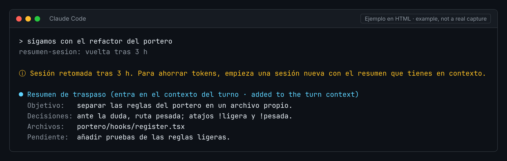

# resumen-sesion

**Español** · [English](#english)

Mod para Claude Code que te ayuda a retomar una sesión tras un rato sin escribir.



*Ejemplo en HTML, no es una captura real.*

## Qué hace

- Si escribes tras 2 horas o más sin actividad, pide a Haiku un resumen de traspaso: objetivo, decisiones, archivos tocados y lo pendiente.
- El resumen entra en el contexto de ese turno, y un aviso te sugiere abrir una sesión nueva.
- ¿Por qué una sesión nueva? Porque en cada turno se vuelve a procesar todo el historial. Empezar de cero con el resumen gasta menos tokens.

Para cambiar las 2 horas, edita `IDLE_MS` en `hooks/register.tsx`.

## Instalación

```
/plugin marketplace add deriva1945-ui/portero-claude
/plugin install resumen-sesion@jarvis-essential-pack
```

## Qué no hace

- No actúa mientras la sesión está parada. Solo actúa cuando vuelves a escribir.
- No abre la sesión nueva por ti: eso lo haces tú.
- Resume solo los últimos 30 mensajes. Si Haiku no responde, no añade nada.

## Licencia

MIT. Ver [LICENSE](LICENSE).

---

<a id="english"></a>

# resumen-sesion (English)

A Claude Code mod that helps you pick a session back up after a break.


*HTML example, not a real screenshot.*

## What it does

- When you type after 2 hours or more of no activity, it asks Haiku for a handover summary: goal, decisions, files touched and what is left.
- The summary is added to that turn's context, and a notice suggests opening a new session.
- Why a new session? Because every turn processes the whole history again. Starting fresh with the summary uses fewer tokens.

To change the 2 hours, edit `IDLE_MS` in `hooks/register.tsx`.

## Install

```
/plugin marketplace add deriva1945-ui/portero-claude
/plugin install resumen-sesion@jarvis-essential-pack
```

## What it does not do

- It does nothing while the session is idle. It only acts when you type again.
- It does not open the new session for you.
- It only summarizes the last 30 messages. If Haiku does not answer, it adds nothing.

## License

MIT. See [LICENSE](LICENSE).
